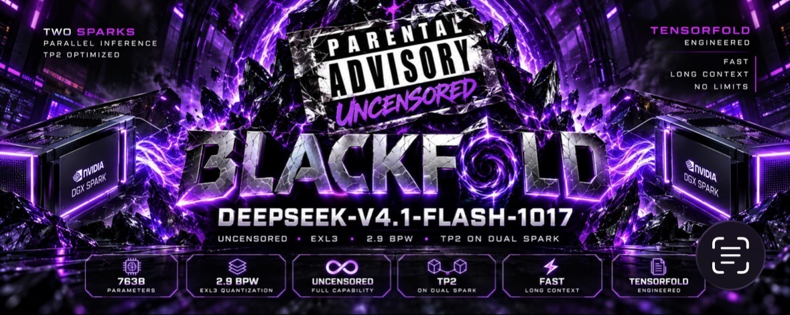
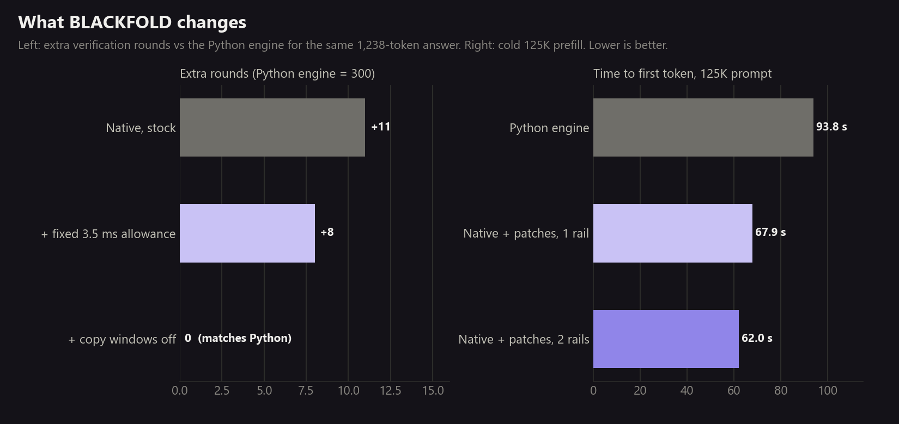
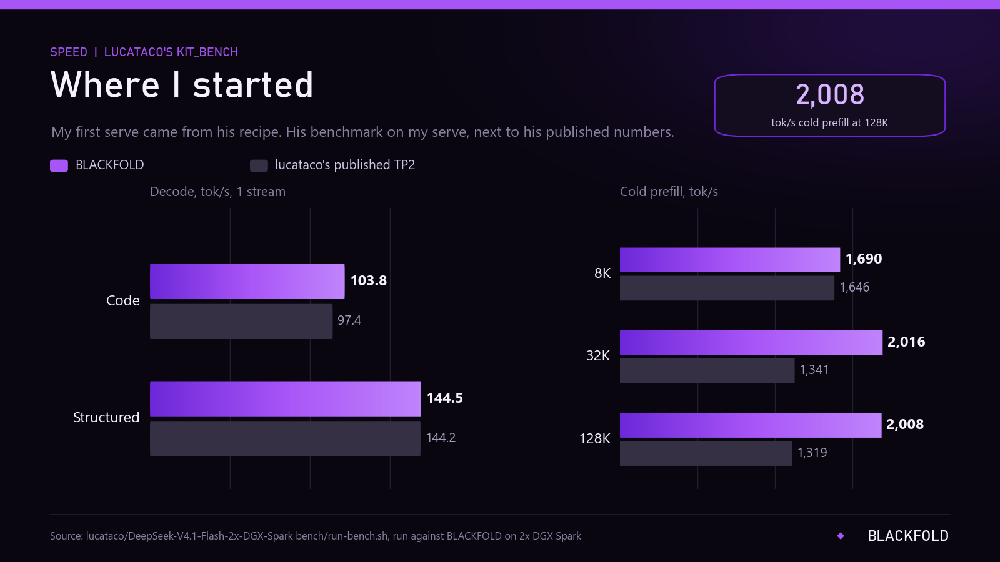
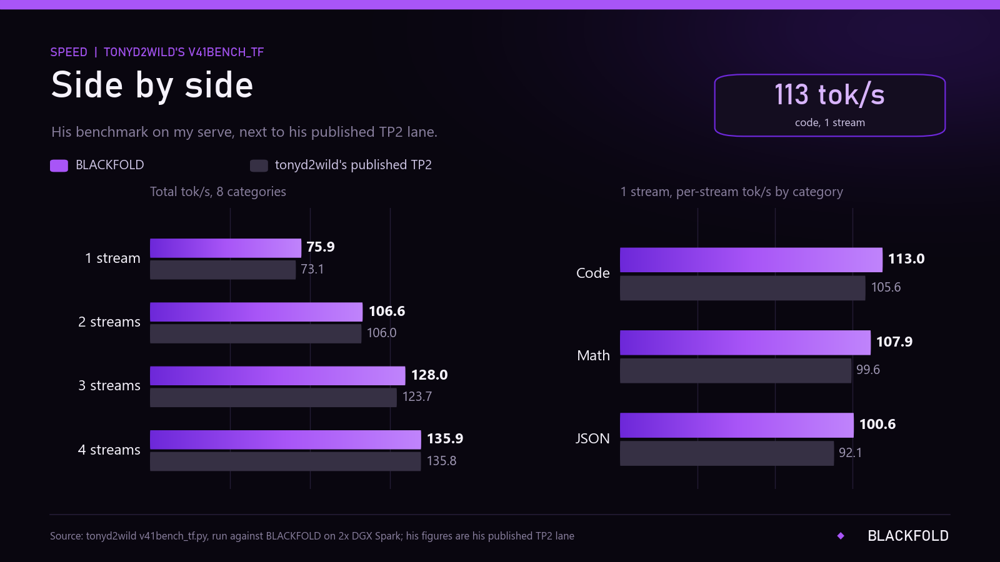
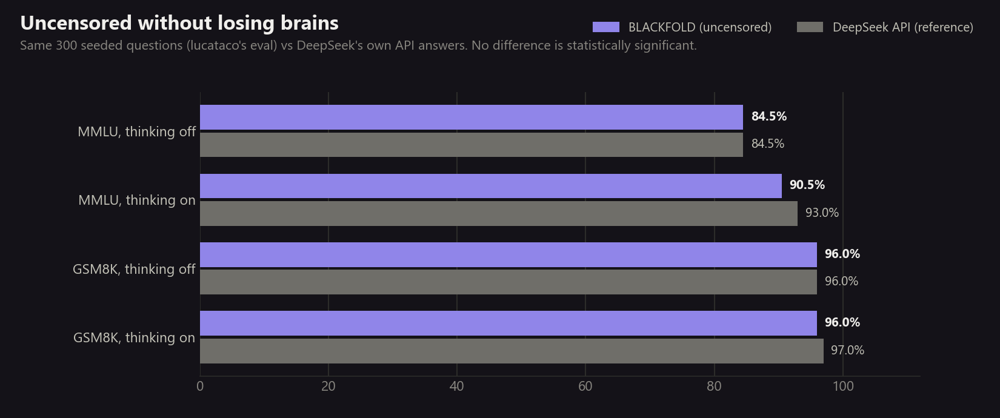
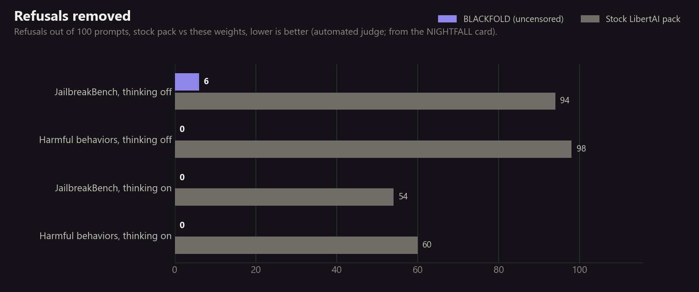

# BLACKFOLD: DeepSeek-V4.1-Flash-1017 TP2 recipe

**Uncensored, fast, and checked.** DeepSeek-V4.1-Flash-1017 (763B MoE) on two DGX Sparks: JailbreakBench
refusals cut from 94 to 6, the same answers as DeepSeek's own API, 2,008 tok/s cold prefill on a 128K prompt and
113 tok/s single-stream code decode.

Those speeds are best cases: greedy, thinking off, short prompts, one request. Prose decodes at about 57-65 tok/s,
and a thinking agent at 150-190K context saw about 57 tok/s. **[Real-world speed](docs/REAL_WORLD_SPEED.md)** shows
what to expect for your use, and what it takes to get these numbers on your own pair.

This is the TP2 recipe: how to run BLACKFOLD on two GB10 nodes with TensorFold's native engine, the three engine
patches that make it fast, the two-rail network setup, and every measurement. The weights live on Hugging Face:

**Model:** [BlackwellBoy/DeepSeek-V4.1-Flash-1017-BLACKFOLD-EXL3-2.9bpw-TP2](https://huggingface.co/BlackwellBoy/DeepSeek-V4.1-Flash-1017-BLACKFOLD-EXL3-2.9bpw-TP2) (gated, responsible-use terms)



## Quick start

**You need:** two DGX Spark (or other GB10, 128 GB) nodes on a 200 GbE link or switch, Docker with the NVIDIA
runtime, `nvcr.io/nvidia/pytorch:26.07-py3`, passwordless SSH from the first node (head) to the second (worker),
and about 520 GB free on each node.

**1. Weights (both nodes).** Request access on the model page, then:
```bash
hf download BlackwellBoy/DeepSeek-V4.1-Flash-1017-BLACKFOLD-EXL3-2.9bpw-TP2 --local-dir blackfold-hf
cd blackfold-hf && ./setup.sh /models     # downloads LibertAI's pack + Engram, applies and verifies the patch
```
Run it on one node and copy `/models` to the other over the fabric, or run it on both.

**2. Base TP2 setup.** Follow [lucataco's two-Spark recipe](https://github.com/lucataco/DeepSeek-V4.1-Flash-2x-DGX-Spark)
with `/models/exl3-2.9bpw-heretic` as the model and `/models/engram-src` as the Engram folder. Its first start
writes the per-rank weight caches (`tf-ds-rank`) and `dsv41_token_map.json`, which the native engine reads. Check
it answers, then stop it (`scripts/start.sh stop`). Get the kernel kit v0.6.1 from
[bertholomus's TP2 recipe](https://github.com/bertholomus/deepseek-v4.1-tensorfold-tp2-2xgb10) and generate the
RoPE tables and the 1017 image-routing bias with its tools, as
[tonyd2wild's TP2 lane](https://github.com/tonyd2wild/DeepSeek-V4.1-Flash-vLLM-DGX-Spark/tree/main/runs/2026-10-18-1017-tensorfold-tp2) documents (step 4).

**3. Build the engine (one node, no GPU needed, then copy `zig-out/` to the other).**
```bash
git clone https://github.com/bertholomus/TensorFold && cd TensorFold
git checkout 6366d2c585b4f05fe33bfe5cbdb33ea15264841a   # includes upstream #25 (DSML tool-call fix)
git apply ../DeepSeek-V4.1-Flash-1017-BLACKFOLD-TP2/patches/000*.patch
# inside nvcr.io/nvidia/pytorch:26.07-py3 with Zig 0.17.0 on PATH:
zig build test        # 227/227
zig build install native -Dtarget=aarch64-linux-gnu.2.28 -Doptimize=ReleaseFast \
  -Dnvcc=/usr/local/cuda/bin/nvcc -Dsm=121
```

**4. Chat template.** The native renderer needs one expression rewritten:
```bash
sed 's/dict(schema.d, \*\*{k: v})/dict((schema.d.items() | list) + [[k, v]])/' \
  chat_template.jinja > chat_template.native.jinja
```

**5. Second rail (optional, about 9% faster cold prefill).** See [docs/RAILS.md](docs/RAILS.md).

**6. Start.** Copy `deploy/blackfold.env.example` to `deploy/blackfold.env`, fill in addresses and paths, then:
```bash
deploy/blackfold-native start      # also: stop, status
curl http://<head>:18191/v1/models
```
OpenAI-compatible API on port 18191: 1M context, 4 parallel streams, vision, tool calls, thinking on by default
(send `chat_template_kwargs: {"enable_thinking": false}` to turn it off per request).

**Before you use it:**
- Structured output (`response_format`, `guided_json`): with patch 0004 it is served by a system-prompt instruction,
  not a decode mask, so validate the JSON yourself; without it the engine answers HTTP 400. See
  [docs/SUSHI_PORT_2026-10-28.md](docs/SUSHI_PORT_2026-10-28.md).
- Set `max_tokens` on requests. Thinking counts against it; the deploy default is now 32,768.
- Keep one thinking setting per conversation, so the prompt cache can reuse earlier turns.
- Leave `top_k` unset or send 1-50: on this engine pin, `top_k` 0 or -1 fails the decode round for every request
  running at that moment.
- Set `API_KEY_FILE` in `blackfold.env` if the port is reachable from other machines.

Details: [Real-world speed](docs/REAL_WORLD_SPEED.md).

## Results

I built on lucataco's and tonyd2wild's TP2 work, so I benchmarked BLACKFOLD with their **own** tools and put it
next to the numbers each of them published for their stock (censored) builds. Raw files and conditions:
[results/](results/RESULTS.md).









## Getting these numbers on your pair

1. Both RoCE rails, MTU 9000, GID aligned ([docs/RAILS.md](docs/RAILS.md)).
2. Matched, unthrottled GPUs. Run `tools/bf_preflight.sh` on both nodes and compare them; the slower node sets the pace.
3. Nothing else running on either node.
4. One warm-up request at your working context size: the first long reply after a start is slow while the engine
   prepares its graphs.
5. Measure with `tools/bf_lab.py` in both regimes, greedy with thinking off and sampled with thinking on
   ([tools/README.md](tools/README.md)). Two runs of the same build match token for token in either.

**Short on disk?** Each node only reads half of the 189 GB Engram tables.
[docs/ENGRAM_DISK.md](docs/ENGRAM_DISK.md) gives ~95 GB back per node, in place, with a start-up check that stops a
node from serving the wrong rank.

## Issues I hit along the way, and the fixes

The TP2 builds I learned from pin TensorFold commits from before some upstream fixes, so I left a note on each repo.

- **lucataco's pin (`8e0966e`)** predates the DSML tool-call fix (#20), so tool-call markup could end up in replies,
  and the RDMA gather's proxy thread spins a core while idle (fixed in #27).
- **tonyd2wild's pin (`3ff3b2a`)** predates the kept-prompt fixes: coming back to a conversation after another one
  with the same system prompt reused 0 cached tokens. On `629c524` (#26) it reuses 98,304. The final save in
  `v41bench_tf.py` also fails if the `--out` folder does not exist yet.
- **TensorFold native at `629c524`** leaked raw DSML when the model called a tool the request did not offer.
  Upstream fixed it in #25, and this recipe pins `6366d2c`, which includes it.
- **Native ran about 3% more verification rounds** than the Python engine for the same answer. Patches `0002` and
  `0003` fix it (below).
- **Tool-only streamed replies** sent a couple of newlines before the call, which strict clients read as content.
  Patch `0001` fixes it.

## What we built

1. **Engine patches** ([patches/](patches/README.md)) on bertholomus/TensorFold `6366d2c` (they also apply to `629c524`):
   - `0001` holds back leading whitespace in streamed replies until it is clear whether a tool call follows
     (tool-call checks 4/8 to 8/8).
   - `0002` lets a backend use a fixed per-round draft allowance for a lone stream; DeepSeek uses its 3.5 ms,
     matching the Python engine.
   - `0003` lets a backend turn off suffix-lookup copy windows; DeepSeek does while its draft head is loaded,
     as the Python engine never proposes copies.
   Both settings are opt-in; other backends keep upstream behaviour.
2. **The finding behind them:** native ran 309 to 311 verification rounds where the Python engine ran 300 for the
   same answer. With 0002 and 0003 it runs exactly 300, and its faster rounds then win.
   [docs/COPY_WINDOWS.md](docs/COPY_WINDOWS.md)
3. **Two rails** with GID alignment that survives reboots and NetworkManager. [docs/RAILS.md](docs/RAILS.md)
4. **Tool calls checked to 250K context:** 32/32 clean (thinking on and off, streamed and not, multi-turn), and
   24/24 DSML edge cases, including a call to a tool the request did not offer, which `629c524` leaked as raw
   markup and upstream fixed in #25. [results/](results/RESULTS.md)
5. **Deploy scripts** ([deploy/](deploy/README.md)) and every measurement in [results/](results/RESULTS.md):
   controlled A/B trials (all outputs identical by token), qualification, same-tool benchmarks and quality.
6. **Measurement tools** ([tools/](tools/README.md)): `bf_lab.py` records and compares a serve by full token IDs and
   engine counters, and `bf_preflight.sh` reports a node's clocks, memory and rails.

| 125K-context cell (same pair) | Python engine | Native + patches, 1 rail | Native + patches, 2 rails |
|---|---:|---:|---:|
| Cold prefill, code prompt | 93.8 s | 67.9 s | **62.0 s** |
| Solo code decode, tok/s | 89.6 | 91.5 | **92.8** |
| Solo prose decode, tok/s | 55.2 | 56.2 | **57.1** |
| 2-stream code, per stream | 63.6 | 68.1 | **69.8** |

## Credits and licence

BLACKFOLD stands on DeepSeek-AI, LibertAIDAI, turboderp, p-e-w, pqhaz, ashhart, bertholomus and the TensorFold
contributors, lucataco, tonyd2wild and MiaAI-Lab: details in [CREDITS.md](CREDITS.md). Our scripts, patches and
documents are Apache-2.0 ([LICENSE](LICENSE), [NOTICE](NOTICE)); the patches modify TensorFold (Apache-2.0), whose
LICENSE and NOTICE are in [patches/](patches/). The weights are MIT and are distributed only through the gated
Hugging Face repository.
